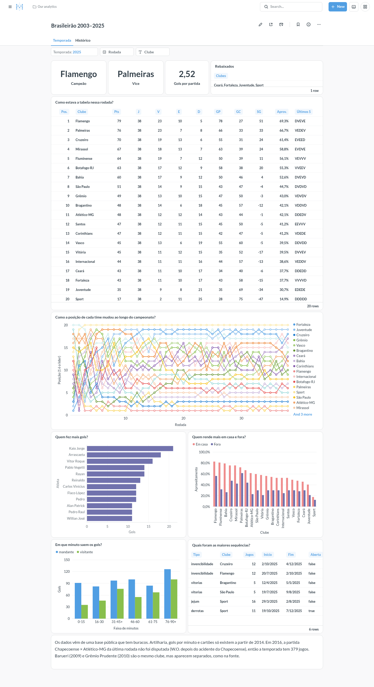
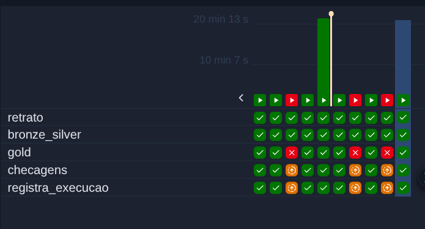

# Brasileirão em PySpark

[](https://github.com/romualdobarbosa/brasileirao/actions/workflows/ci.yml)

Fiz este projeto para o portfólio, com a ideia de mostrar o motor do Spark trabalhando (window functions, MERGE, broadcast, explain plan) além da arquitetura medallion. Peguei o histórico do Campeonato Brasileiro Série A de 2003 a 2025, são 9.165 partidas, e montei um pipeline batch em PySpark com Delta Lake que responde perguntas como quem liderava o campeonato na rodada 20 de 2009, qual foi a maior sequência sem vitória do seu time ou quem foi o artilheiro de cada ano.

Para ver o resultado sem instalar nada, é só abrir o app [brasileirao-serie-a.streamlit.app](https://brasileirao-serie-a.streamlit.app/). Lá você escolhe dois clubes e vê o confronto direto, ou olha quem mais virou jogo e quem caiu com mais pontos. É de graça e sem login. O app hiberna quando fica sem uso, então pode ser que você precise clicar para acordá-lo e esperar um pouco.

Os dados vêm do dataset [Campeonato Brasileiro de Futebol](https://www.kaggle.com/datasets/adaoduque/campeonato-brasileiro-de-futebol), do Adão Duque, no Kaggle (versão 18).

## Como está organizado

O pipeline segue as três camadas de sempre, todas em Delta Lake e rodando local.

- Bronze, os CSVs do Kaggle como vieram, com metadado de origem e particionados por temporada.
- Silver, os dados limpos e tipados, com os nomes dos times padronizados ("Gremio" vira "Grêmio") e os nomes dos jogadores trocados pelo nome que o torcedor conhece ("Gabriel Barbosa" vira "Gabigol").
- Gold, 18 tabelas analíticas. São elas que o app lê, e oito delas também vão para o Postgres local.

A carga é por temporada e idempotente, ou seja, reprocessar 2019 duas vezes deixa as tabelas exatamente como uma vez só. Cada camada chega nisso de um jeito. A bronze e as tabelas de gols, cartões e estatísticas da silver substituem a partição da temporada inteira (`replaceWhere`), porque essas tabelas não têm uma chave confiável. As partidas da silver têm chave (`partida_id`), então usam `MERGE` e só gravam o que mudou, de modo que uma recarga sem novidade nem cria versão nova no Delta.

## Como reproduzir

Precisa de Python 3.12, [uv](https://docs.astral.sh/uv/) e Java 17 ou mais novo.

```bash
make setup                       # instala as dependências
make download                    # baixa os CSVs do Kaggle para data/raw/
make lakehouse                   # carrega bronze e silver de todas as temporadas encerradas
make lakehouse TEMPORADA=2019    # ou só uma temporada
make gold                        # gera as tabelas gold em data/gold/
make exportar                    # grava o gold em app/dados/, um Parquet por tabela
make app                         # abre o app em localhost:8501
make explain                     # gera os planos físicos em docs/explain/planos/
make test                        # testes com cobertura
make lint                        # ruff
```

O dataset é público e baixa sem login. A temporada em andamento fica fora do pipeline até terminar.

## As tabelas do gold

| Tabela | O que tem |
|---|---|
| `classificacao_por_rodada` | a tabela do campeonato em cada rodada, com pontos, saldo, aproveitamento e os últimos 5 resultados |
| `desempenho_mandante_visitante` | o desempenho de cada time em casa e fora |
| `sequencias` | a maior sequência de invencibilidade, de vitórias, de jejum e de derrotas de cada time por temporada |
| `ranking_historico` | o acumulado de cada clube de 2003 a 2025, com títulos |
| `disciplina` | cartões amarelos e vermelhos por time e temporada |
| `artilharia` | os goleadores de cada temporada, com pênaltis e clubes |
| `gols_por_minuto` | em que faixa do jogo saem os gols, separando mandante e visitante |
| `resumo_temporada` | campeão, vice, rebaixados, artilheiro, média de gols e quanto o mandante vence |
| `confrontos` | o histórico de cada clube contra cada adversário, com maior vitória, maior derrota e último jogo |
| `goleadas` | os jogos com diferença de 4 gols ou mais, ou com 8 gols ou mais no total |
| `campanhas` | a campanha final de cada clube por temporada, com a situação (campeão, vice, rebaixado ou permaneceu) |
| `linha_corte` | o último salvo e o primeiro rebaixado de cada ano, com pontos e aproveitamento |
| `passagens_tecnicos` | cada passagem de técnico por clube e temporada, com o aproveitamento |
| `esquemas_taticos` | o uso e o rendimento de cada esquema por temporada |
| `viradas` | os jogos em que um clube esteve atrás no placar e venceu |
| `gols_decisivos` | gols depois dos 85 minutos e nos acréscimos, com os pontos ganhos e perdidos nessa faixa |
| `cartoes_jogadores` | amarelos e vermelhos por jogador, clube e temporada |
| `faltas_clubes` | faltas por clube e temporada, com a média por jogo |

A classificação é feita só com window functions, sem nenhum loop por rodada, e as sequências e as passagens de técnico usam a técnica de gaps-and-islands. As viradas reconstroem o placar gol a gol, também com window function. Em [docs/explain](docs/explain/README.md) eu comento os planos físicos de três das tabelas e explico por que nenhuma tabela do gold é particionada.

As punições do STJD entram por uma tabela versionada (`reference/ajustes_pontos.csv`), com o motivo e a fonte de cada uma. Com elas, a classificação final das temporadas afetadas bate com a oficial. Os pontos tirados da Portuguesa e do Flamengo em 2013, por exemplo, estão lá.

## O app

O [app](https://brasileirao-serie-a.streamlit.app/) tem oito páginas, Temporada, Histórico, Confronto direto, Viradas e fim de jogo, Rebaixamento e campanhas, Goleadas, Técnicos e esquemas, e Disciplina. Cada uma diz qual período cobre, porque nem todo dado existe em todo ano.

O Spark faz a conta pesada e o app só lê o resultado. O `make exportar` grava cada tabela do gold em `app/dados/`, esses Parquet ficam no git, e o Streamlit abre os arquivos com pandas e faz só filtros e somas simples. O app publicado instala apenas o `app/requirements.txt`, que não tem PySpark, e não usa banco nem IA.

## Postgres e Metabase, na minha máquina

Antes do app, montei uma camada de serving com Postgres e Metabase em Docker Compose, com carga do gold por JDBC que o dashboard nunca vê pela metade, um usuário que só pode ler e 12 perguntas em duas abas. Ela roda local, com as oito tabelas originais do gold.



O plano era publicar isso numa VM gratuita da Oracle. Só que o cadastro no Brasil me pediu CNPJ, que eu não tenho, e por isso o link público virou o Streamlit. As peças de deploy continuam no repositório, prontas e sem nunca terem rodado em produção. A história completa, os prints e como rodar estão em [docs/serving](docs/serving/README.md).

## Delta além do MERGE

Depois do pipeline pronto, fui usar o resto do Delta. As tabelas ganharam constraints, que recusam a escrita inválida na própria tabela, e passei por histórico, `OPTIMIZE`, Z-Order, `VACUUM` e time travel com saídas reais, no lake ou numa cópia dele. Está tudo em [docs/delta](docs/delta/README.md), inclusive o que surpreendeu e o que não fez diferença num lake deste tamanho.

Também medi onde estava o tempo dos testes antes de mexer em configuração. O `make test` local caiu de 368,2 s para 198,4 s e o job de testes do CI de 580 s para 352 s, sem tirar teste e com o gold idêntico. As tentativas que pioraram o tempo também estão anotadas em [docs/tuning](docs/tuning/README.md).

## O mesmo código no Databricks e na AWS

Eu queria ver o pipeline rodando fora da minha máquina sem reescrever nada. No [Databricks Free Edition](docs/databricks/README.md), em compute serverless e a partir do wheel do pacote, as 22 tabelas da silver e do gold saíram iguais às locais, conferidas por sha256, sem gastar nada.

Na [AWS](docs/aws/README.md), o Spark continua na minha máquina e o lake vai para um bucket S3, porque o plano gratuito bloqueia o EMR e o Glue Jobs e eu não quis liberar cobrança no cartão. Toda a infraestrutura sai do Terraform (S3, IAM, Glue Data Catalog, Athena e um budget com alerta), com `apply` e `destroy` de verdade, e o Athena consulta a silver e o gold pelo catálogo. As 22 tabelas no S3 bateram com as locais. O `plan` também rodou pelo GitHub Actions, com uma role de só leitura assumida por OIDC, sem chave guardada no repositório.

## Rodada a rodada, no Airflow

O dataset termina em dezembro de 2025, então não tem temporada em andamento para acompanhar. Simulei uma. O `brasileirao.simulacao` monta a fonte como ela estaria depois da rodada N de 2025, com jogo adiado e placar corrigido no meio, num lake separado em `data_sim/`, e o Change Data Feed do Delta mostra o que mudou na silver de uma rodada para a outra. Depois das 38 rodadas, as 22 tabelas da silver e do gold ficam iguais às do pipeline normal, conferidas por sha256.

Cada rodada vira uma execução da DAG `brasileirao_rodada` no Airflow 3.4.0, em Docker na minha máquina, com uma tarefa por etapa. Provoquei falhas de verdade, apagando uma partida da silver, e o gold reprovou sem gravar nada e segurou as tarefas seguintes. Toda execução fica registrada na tabela Delta `ops/execucoes`, que o `make status` mostra, e a falha manda um e-mail. Uma rodada também rodou com o lake no S3, mas levou 1213 s contra 191 s no local. Os prints, as saídas e os limites estão em [docs/orchestration](docs/orchestration/README.md).



## O que a fonte não resolve

A fonte tem buracos, e é melhor saber onde estão antes de tirar conclusão de alguma tabela.

- Gols, cartões e estatísticas só existem a partir de 2014. Antes disso tem só partida e placar, então artilharia, disciplina e gols por minuto cobrem 2014 a 2025.
- 2025 não tem cartões e 2024 não tem estatísticas. A `disciplina` de 2025 usa a contagem de cartões do arquivo de estatísticas, que conta um pouco diferente (em 2017, por exemplo, são 1.811 amarelos num arquivo e 1.773 no outro).
- A fonte usa às vezes o apelido e às vezes o nome de registro (Hulk aparece como Hulk, mas o Marinho aparece como Mário Sérgio Santos Costa), e ainda junta jogadores diferentes que têm o mesmo nome. Eu corrigi isso à mão para quem já esteve entre os 10 artilheiros de alguma temporada e para quem aparece no alto dos rankings de cartões (`reference/atletas.csv`), e foi assim que o Fred do Grêmio de 2016, que é outro jogador, parou de somar gols no Fred artilheiro. Quem está fora desses grupos continua com o nome que veio da fonte, e alguns ficaram assim de propósito porque não consegui confirmar se o apelido era da mesma pessoa.
- A coluna de técnico de 2025 está errada na fonte (o Cruzeiro aparece com o Tite em 36 jogos, e ele só foi anunciado em dezembro), então `passagens_tecnicos` vai de 2014 a 2024. Os esquemas começam em 2015, porque 2014 tem só 16 partidas com formação.
- Faltas não existem em 2024, e 2019 tem 714 dos 760 jogos, por isso o app mostra a média por jogo. E `gols_acrescimo` é um piso, porque parte dos gols no minuto 90 vem sem o acréscimo preenchido.
- A classificação desempata por pontos, vitórias, saldo e gols pró. O confronto direto e os cartões, que a CBF usa depois, ficaram de fora.
- Dois placares divergem do oficial por um gol, Athletico-PR × Criciúma em 2003 e Internacional × Criciúma em 2004. Os pontos não mudam, então deixei como veio.
- Chapecoense × Atlético-MG, da última rodada de 2016, não foi jogada por causa da queda do avião da Chapecoense. A tabela oficial conta W.O. duplo, aqui os dois times ficam com 37 jogos. Pontos e posições são os mesmos.

## O que ficou de fora

O enriquecimento com a Base dos Dados não entrou, porque a licença do dado está registrada como desconhecida e o dado foi raspado do Transfermarkt ([sondagem](docs/enriquecimento/sondagem.md)). Cluster, streaming e serving em produção também ficaram de fora, porque o volume (uns 10 MB no lake inteiro) não justifica.

O mapa dos módulos está em [CAPABILITY_MAP.md](CAPABILITY_MAP.md), e cada um tem a sua spec na raiz do repositório.
