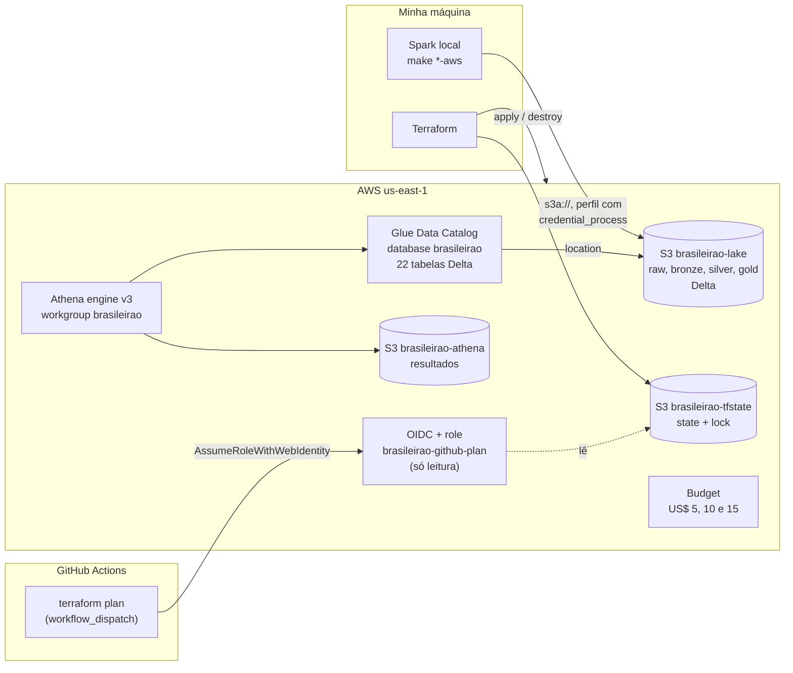

# O pipeline com o lake na AWS

O mesmo código do local roda com o Spark na minha máquina, mas lê e grava o lake (bronze, silver e gold em Delta) num bucket S3. O Athena consulta a silver e o gold pelo Glue Data Catalog, e toda a infraestrutura sai do Terraform, com `apply` e `destroy` de verdade. As 22 tabelas da silver e do gold no S3 têm as mesmas linhas e o mesmo sha256 das locais.

O volume é pequeno, uns 10 MB no lake inteiro, e daria para fazer tudo sem Spark. Ele está ali porque o projeto é para mostrar a stack (lembrando que é um projeto de portfólio). Os detalhes de cada etapa, com os erros e os tempos, estão em [`sondagem.md`](sondagem.md).

## Por que não tem EMR

A conta está no Free plan da AWS, com crédito e sem cartão cobrando. Nele, o EMR Serverless responde `SubscriptionRequiredException` e o `CreateJob` do Glue responde `AccessDeniedException: Account ... is denied access`, mesmo com o IAM liberando (conferi com o simulador do IAM, e a conta não tem SCP). O upgrade para o Paid plan resolveria, mas aí a conta passa a poder cobrar no cartão, e eu não quis. Fiquei com o Spark local gravando no S3. O Glue Data Catalog e o Athena funcionam no Free plan.

## Desenho



## Passo a passo

Antes de tudo, você precisa do Terraform 1.17.2, da AWS CLI com o `aws login` feito e do `uv sync` do projeto.

1. **Perfil da credencial.** Em `~/.aws/config`, o perfil guarda o comando, não o segredo. O SDK do Spark roda o comando de novo quando a credencial está para vencer.

   ```ini
   [profile brasileirao]
   region = us-east-1
   credential_process = aws configure export-credentials --profile default --format process
   ```

2. **Bootstrap, uma vez.** Cria o bucket do state e a role do GitHub (OIDC). Fica de pé entre sessões.

   ```bash
   export AWS_PROFILE=brasileirao
   terraform -chdir=infra/bootstrap init
   terraform -chdir=infra/bootstrap apply
   ```

3. **Stack principal.** O e-mail dos alertas do budget vem do ambiente.

   ```bash
   export TF_VAR_email_alerta=...
   terraform -chdir=infra/main init -backend-config="bucket=brasileirao-tfstate-<conta>"
   terraform -chdir=infra/main apply
   ```

4. **Pipeline.** Cada alvo usa `AWS_PROFILE=brasileirao` (dá para trocar) e aponta o `BRASILEIRAO_DATA_ROOT` para o bucket do lake.

   ```bash
   make raw-aws                       # CSVs de data/raw/ para s3://<lake>/raw/
   make lakehouse-aws                 # 23 temporadas num processo só (TEMPORADA=2019 para uma)
   make gold-aws
   make foto-aws SAIDA=foto_aws.json  # linhas e sha256, para comparar com o local
   ```

5. **Consulta no Athena**, no console (workgroup `brasileirao`) ou pela CLI:

   ```bash
   aws athena start-query-execution --work-group brasileirao --query-string \
     "SELECT posicao, clube, pontos, jogos, vitorias, empates, derrotas, gols_pro, gols_contra, saldo
        FROM brasileirao.gold_classificacao_por_rodada
       WHERE temporada = 2019 AND rodada = 38 ORDER BY posicao LIMIT 4"
   ```

6. **Destroy no fim da sessão.** O `force_destroy` dos buckets leva o lake junto.

   ```bash
   terraform -chdir=infra/main destroy
   ```

## A consulta no Athena

As tabelas do Glue só dizem onde está cada tabela Delta e que o provider é `delta`. O Athena lê o schema e as estatísticas direto do `_delta_log`, então não repito colunas no Terraform. Rodei em 11/11/2026 a consulta do passo 5 sobre o gold gravado no S3:

| posicao | clube | pontos | jogos | vitorias | empates | derrotas | gols_pro | gols_contra | saldo |
|---:|---|---:|---:|---:|---:|---:|---:|---:|---:|
| 1 | Flamengo | 90 | 38 | 28 | 6 | 4 | 86 | 37 | 49 |
| 2 | Santos | 74 | 38 | 22 | 8 | 8 | 60 | 33 | 27 |
| 3 | Palmeiras | 74 | 38 | 21 | 11 | 6 | 61 | 32 | 29 |
| 4 | Grêmio | 65 | 38 | 19 | 8 | 11 | 64 | 39 | 25 |

Terminou `SUCCEEDED` no engine 3 em 1,8 s, com 115.203 bytes lidos, e bate linha a linha com o gold local. Um `count(*)` em `silver_partidas` devolveu 9.165, o mesmo número da foto.

<!-- print: a consulta acima no editor do Athena, com o resultado e os bytes lidos -->

<!-- print: o bucket brasileirao-lake no console do S3, com as pastas raw, bronze, silver e gold -->

## Plan pelo GitHub

O workflow [`terraform-plan.yml`](../../.github/workflows/terraform-plan.yml) roda só à mão (`workflow_dispatch`). Ele assume a role `brasileirao-github-plan` por OIDC, sem chave guardada no GitHub, e faz `terraform plan` do `infra/main`. A role só confia em execuções da `main` deste repositório e só lê os recursos do projeto e o state. A única escrita é no arquivo de lock. As permissões saíram das chamadas que um plan fez de verdade, e nenhuma usa `*` como recurso. Apply continua sendo só local.

O workflow precisa de duas coisas no repositório:

- a variável `AWS_PLAN_ROLE_ARN`, com o output `github_plan_role_arn` do bootstrap;
- o secret `TF_VAR_EMAIL_ALERTA`, com o mesmo e-mail do budget. Com outro valor, o plan mostraria uma troca no budget que não existe. O Terraform marca a variável como sensível e o Actions mascara o secret no log.

## Gasto

Os créditos estavam em US$ 119,95 antes do AW3. O gasto é só de requisições ao S3, de alguns MB guardados por poucas horas e dos MB lidos pelo Athena. O budget `brasileirao-cost-guard` avisa por e-mail em US$ 5, 10 e 15, sem o crédito no cálculo.

<!-- conferir: saldo de créditos depois do AW3 -->

<!-- print: o budget brasileirao-cost-guard no console, com os três alertas -->
