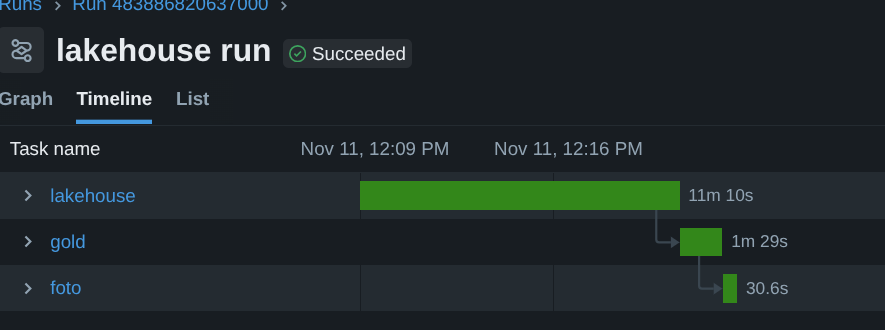

# O pipeline no Databricks

Eu queria ver o mesmo código rodando fora da minha máquina, sem reescrever nada. O bronze → silver → gold do `make lakehouse` + `make gold` rodou no Databricks Free Edition, em compute serverless, a partir do wheel do pacote, e as 22 tabelas (4 silver e 18 gold) saíram iguais às do local, linha por linha. Não gastei nada e não mexi no código do pacote para isso. A camada de ambiente (`BRASILEIRAO_SPARK_ENV=databricks`) veio do passo anterior, e a sondagem mostrou que ela bastava.

Tudo o que está aqui rodou em 11/11/2026. Os scripts usados estão em [`databricks/`](../../databricks/).

## Como rodar

Precisa de uma conta no Free Edition, de um token no perfil `DEFAULT` de `~/.databrickscfg` (o SDK lê de lá, e nenhum script toca na credencial) e de um Volume `workspace.default.brasileirao`.

1. Enviar os 4 CSVs de `data/raw/` para `/Volumes/workspace/default/brasileirao/raw/`. Eu fiz isso pela interface, e os arquivos são idênticos aos do local.
2. Gerar o wheel e subir para o Volume (sobrescreve o que estiver lá):

   ```bash
   make wheel
   uv run -q --no-project --with databricks-sdk python -I databricks/submeter.py wheel
   ```

3. Sondagem (opcional, uns 2 minutos):

   ```bash
   uv run -q --no-project --with databricks-sdk python -I databricks/submeter.py sondagem
   ```

4. Pipeline completo:

   ```bash
   uv run -q --no-project --with databricks-sdk python -I databricks/submeter.py pipeline
   ```

O `submeter.py` sobe `sondagem.py`, `executar.py` e `foto.py` como arquivos do workspace em `/Users/<usuário>/brasileirao/` e chama `jobs.submit`. É um run avulso: não fica job salvo nem agendamento. Cada task é uma `spark_python_task` serverless com um environment (versão 4, Python 3.12) cuja única dependência é o wheel no Volume. O script imprime o `run_id`, o link e espera o fim.

O run do pipeline tem três tasks em sequência:

| Task | O que faz | Equivalente local |
|---|---|---|
| `lakehouse` | `executar.py lakehouse --todas` | `make lakehouse` |
| `gold` | `executar.py gold` | `make gold` |
| `foto` | `foto.py /Volumes/.../brasileirao /Volumes/.../foto.json` | `uv run python databricks/foto.py ./data foto.json` |

O `executar.py` só fixa `BRASILEIRAO_SPARK_ENV=databricks` e `BRASILEIRAO_DATA_ROOT=/Volumes/workspace/default/brasileirao` e chama a mesma CLI do local, `brasileirao.pipeline.main`. Bronze, silver e gold são criados dentro do Volume.



O fim do log da task `lakehouse` no mesmo run, com a última das 23 temporadas:

```text
INFO brasileirao.ingestion.bronze: bronze/partidas temporada 2025: 380 linhas
INFO brasileirao.ingestion.bronze: bronze/gols temporada 2025: 959 linhas
INFO brasileirao.ingestion.bronze: bronze/cartoes temporada 2025: 0 linhas
INFO brasileirao.ingestion.bronze: bronze/estatisticas temporada 2025: 760 linhas
INFO brasileirao.transform.silver: silver/partidas temporada 2025: 380 linhas
INFO brasileirao.transform.silver: silver/gols temporada 2025: 959 linhas
INFO brasileirao.transform.silver: silver/cartoes temporada 2025: 0 linhas
INFO brasileirao.transform.silver: silver/estatisticas temporada 2025: 760 linhas
WARNING brasileirao.transform.silver: silver/estatisticas temporada 2025: nulos em colunas opcionais: posse_de_bola=12, precisao_passes=8
INFO brasileirao.pipeline: temporada 2025 processada em 29.2s
```

## Runs

| Run | O que foi | Resultado |
|---|---|---|
| [90604788118025](https://dbc-35e54b07-eefa.cloud.databricks.com/?o=7474656350159983#job/1066786053639207/run/90604788118025) | sondagem | sucesso, 97 s |
| [718991517777062](https://dbc-35e54b07-eefa.cloud.databricks.com/?o=7474656350159983#job/250967947444063/run/718991517777062) | pipeline, lake vazio | `lakehouse` (717 s) e `gold` (161 s) com sucesso; `foto` falhou por erro no script de foto, já corrigido |
| [483886820637000](https://dbc-35e54b07-eefa.cloud.databricks.com/?o=7474656350159983#job/530760159770253/run/483886820637000) | pipeline de novo, sobre o lake do run anterior | sucesso: `lakehouse` 667 s, `gold` 88 s, `foto` 29 s; 810 s no total |

Antes desses, um primeiro run de sondagem (`452411440381283`) morreu com SIGABRT ao importar o `psycopg`, o que levou ao isolamento desse import num subprocesso (ver abaixo).

O segundo run do pipeline também serviu de teste de reexecução. A silver já existia, então `partidas` passou pelo `MERGE` e as constraints já estavam nas tabelas. Os avisos de nulos em colunas opcionais são os mesmos do local.

## Comparação com o local

O `foto.py` lê cada tabela de silver e gold, ordena as linhas serializadas em JSON e tira o sha256. O mesmo script rodou no local, sobre `data/`, e como task do job, sobre o Volume. As duas fotos estão em [`foto_local.json`](foto_local.json) e [`foto_databricks.json`](foto_databricks.json).

| Tabela | Linhas | sha256 |
|---|---:|---|
| silver/partidas | 9165 | igual |
| silver/gols | 10820 | igual |
| silver/cartoes | 20953 | igual |
| silver/estatisticas | 7580 | igual |
| gold/classificacao_por_rodada | 18332 | igual |
| gold/cartoes_jogadores | 5891 | igual |
| gold/artilharia | 3614 | igual |
| gold/sequencias | 1880 | igual |
| gold/confrontos | 1546 | igual |
| gold/desempenho_mandante_visitante | 940 | igual |
| gold/passagens_tecnicos | 859 | igual |
| gold/campanhas | 470 | igual |
| gold/viradas | 447 | igual |
| gold/goleadas | 382 | igual |
| gold/disciplina | 240 | igual |
| gold/gols_decisivos | 240 | igual |
| gold/esquemas_taticos | 202 | igual |
| gold/faltas_clubes | 200 | igual |
| gold/gols_por_minuto | 144 | igual |
| gold/ranking_historico | 46 | igual |
| gold/linha_corte | 23 | igual |
| gold/resumo_temporada | 23 | igual |

Não há diferença a explicar em silver e gold. A bronze não foi comparada e tem uma diferença conhecida. A coluna `_source_file` vem de `_metadata.file_path`, que no local é `file:/.../data/raw/...` e no Databricks é `dbfs:/Volumes/workspace/default/brasileirao/raw/...`; `_ingested_at` também muda a cada execução. Nenhuma das duas chega à silver.

## O que a sondagem mostrou

Resultado completo em [`sondagem.json`](sondagem.json). O ambiente foi o environment serverless versão 4, com Python 3.12.3, Spark Connect com servidor 4.2.0, cliente `pyspark 4.0.0+databricks.connect.17.3.15`, `delta-spark 3.4.0+databricks.connect.17.3.15`, fuso da sessão `Etc/UTC`.

| Item | Resultado |
|---|---|
| `localCheckpoint()` | funciona |
| `cache()` / `persist()` | **falha** no environment 4: `CACHE_REQUIRES_NEWER_CLIENT_ON_SERVERLESS_GC`, pede environment 5 ou superior |
| Padrão do `gravar_merge` com `localCheckpoint` | as linhas alteradas ficam iguais antes e depois do `MERGE`; o alvo termina certo |
| `from delta.tables import DeltaTable`, `forPath`, `isDeltaTable`, `merge`, `delete`, `history`, `detail` | funcionam |
| `replaceWhere` com overwrite de partição | funciona |
| `_metadata.file_path` na leitura do CSV | funciona, com prefixo `dbfs:` |
| `ALTER TABLE delta.\`/Volumes/...\` ADD CONSTRAINT` | funciona, e a constraint aparece em `detail().properties` |
| Constraint violada no `ADD` | `AnalysisException` com condição `DELTA_NEW_CHECK_CONSTRAINT_VIOLATION`, a mesma que `constraints.py` trata |
| Escrita que viola constraint | recusada (`DELTA_VIOLATE_CONSTRAINT_WITH_VALUES`) |
| `spark.conf.set("spark.sql.shuffle.partitions", ...)` | funciona |
| `get_spark()` com `BRASILEIRAO_SPARK_ENV=databricks` | devolve a sessão Spark Connect do Databricks |
| Instalação do wheel com as dependências | instala; `kagglehub` importa |
| `import psycopg` | **derruba o Python** com SIGABRT: `OpenSSL internal error: FATAL FIPS SELFTEST FAILURE`, vindo do `psycopg-binary` |
| `import brasileirao.pipeline` | funciona e não carrega `psycopg` nem `kagglehub` |

## Limites encontrados e o que mudou

- **Nada mudou em `src/`.** O `materializar(df)` do ticket anterior continua com o padrão `local_checkpoint`, que funciona no serverless. O modo `cache` existe, mas no environment 4 falha; ele só serviria num environment 5 ou mais novo, que não foi testado. Por isso não foi preciso criar o terceiro modo, de escrita temporária.
- **`psycopg` não pode ser importado lá.** O pipeline não importa, porque `carga` e `exportar` já importam o `serving` só dentro do próprio subcomando. O wheel ainda declara `kagglehub` e `psycopg[binary]` como dependências e o environment instala os dois sem conflito aparente. Quem chamar `carga` no Databricks derruba o processo. Serving está fora do escopo da spec.
- **`manutencao` não roda lá.** `lake/manutencao.py` usa `sparkContext._jvm`, que não existe no Spark Connect. Não foi chamado.
- **Cota diária do Free Edition.** Os quatro runs (duas sondagens e dois pipelines) couberam no mesmo dia sem aviso de cota.
- **Sem Spark UI.** A evidência vem do log das tasks e do histórico do run.
- **Tempo.** No serverless, cada temporada levou entre 24 e 36 s nos dois runs, e as 23 temporadas somaram 661 s no lake vazio e 632 s na reexecução. Para onde vai esse tempo não foi medido.

## O que fica no Databricks

- Volume `/Volumes/workspace/default/brasileirao/`: `raw/`, `wheels/`, `bronze/`, `silver/`, `gold/`, `foto.json` e `sondagem/` (tabelas pequenas de teste e o `resultado.json`).
- Workspace `/Users/<usuário>/brasileirao/`: `sondagem.py`, `executar.py`, `foto.py`.
- Nenhum job salvo, nenhum agendamento. Os runs avulsos ficam no histórico de Job Runs.
