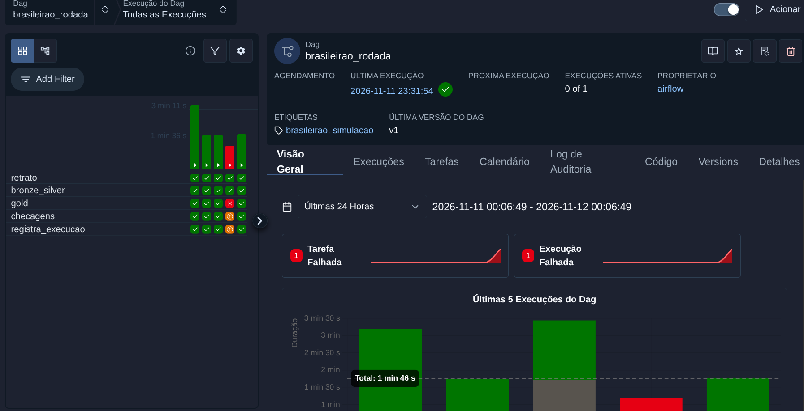
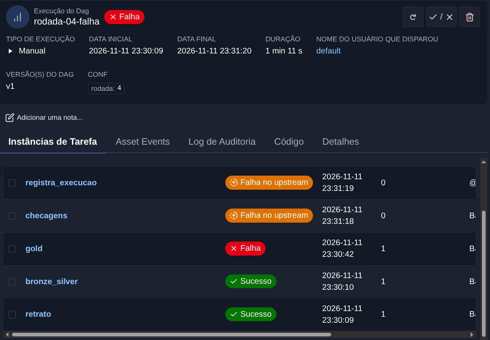

# Orquestração com Airflow

A [simulação](simulacao.md) roda rodada a rodada pelo `make simulacao`, num processo só. Aqui ela ganha uma DAG no Airflow, com uma tarefa por etapa, para que cada rodada apareça como uma execução com estado, log e tempo de cada passo, e para que uma etapa que falha segure as seguintes.

Tudo continua sendo simulação, num lake separado em `data_sim/`. A DAG nunca exporta para `app/dados` e não toca no `./data`.

## O que sobe

`orchestration/` tem o compose e a imagem, separados do [serving](../serving/).

| Peça | Versão | Observação |
|---|---|---|
| Airflow | 3.4.0 (`apache/airflow:3.4.0-python3.12`) | A estável mais recente no PyPI em 11/11/2026 |
| Executor | `LocalExecutor` | As tarefas rodam como processos do scheduler, sem Redis nem worker |
| Banco do Airflow | `postgres:17.11` | Banco e volume próprios, sem porta publicada, então não disputa a 5432 com o Postgres do serving |
| Java | Temurin 21.0.13 (`eclipse-temurin:21.0.13_9-jre`) | O mesmo Java 21 do CI, suportado pelo PySpark 4.2.0 |
| Projeto | `pyspark==4.2.0`, `delta-spark==4.4.1` e o pacote `brasileirao` | Instalados na imagem junto com o Airflow fixado, e um teste confere que as versões batem com o `pyproject.toml` |
| AWS CLI | 2.38.0 | Só para o alvo `aws` |

Os serviços são `postgres`, `airflow-init` (migra o banco e sai), `airflow-apiserver` (interface e API em `127.0.0.1:8080`), `airflow-scheduler` e `airflow-dag-processor`. Não tem triggerer porque a DAG não usa tarefa adiável.

O que fica montado no container.

- `orchestration/dags` em `/opt/airflow/dags`, só leitura.
- `data/raw` (a fonte completa) em `/opt/brasileirao/data/raw`, só leitura.
- `data_sim` em `/opt/brasileirao/data_sim`, onde a simulação grava.
- O volume `ivy` guarda os jars do Delta que o Spark baixa na primeira sessão. Da segunda em diante o log da tarefa mostra `0 artifacts copied, 33 already retrieved`.
- `postgres` e `logs` guardam o banco e os logs das tarefas entre um `down` e outro `up`.

O container roda com o UID do seu usuário, então o que o Airflow grava em `data_sim/` continua sendo seu. A interface não pede login, porque só escuta em `127.0.0.1`.

Segredo nenhum vai para o git. Na primeira vez, o `make airflow-up` cria o `orchestration/.env` (fora do git, modelo em `orchestration/.env.example`) com o seu UID, a senha do Postgres do Airflow, o segredo dos tokens entre os componentes e a chave Fernet, todos aleatórios.

## Como subir e disparar

```
make download                     # se ainda não tiver data/raw
make simulacao-preparar HISTORICO=1
make airflow-up                   # build da imagem, sobe e espera tudo ficar saudável
make airflow-rodada RODADA=1      # dispara uma execução da DAG
make airflow-estado               # execuções da DAG
make airflow-estado RUN=<run_id>  # estado de cada tarefa de uma execução
make airflow-down                 # derruba e mantém os volumes
```

A interface fica em http://127.0.0.1:8080. O primeiro build levou 103 s e o primeiro `up`, com a migração do banco, 104 s.

O `simulacao-preparar` esvazia `data_sim/` sem apagar a pasta. Isso importa porque ela está montada no container, e uma pasta apagada e criada de novo só apareceria lá depois de reiniciar o Airflow.

## A DAG `brasileirao_rodada`

```
retrato → bronze_silver → gold → checagens → registra_execucao
```

| Tarefa | O que faz |
|---|---|
| `retrato` | Grava em `raw/` o retrato da fonte depois da rodada, com os eventos de adiamento e placar corrigido. Só arquivo, sem abrir o Spark |
| `bronze_silver` | `lakehouse --em-andamento` da temporada 2025 a partir do retrato |
| `gold` | O gold com as checagens de temporada parcial. Se reprovar, a tarefa falha e nada é gravado |
| `checagens` | Confere se `silver/partidas` tem as mesmas partidas de 2025 que o retrato e se o Change Data Feed da rodada bate com a comparação de versões. Imprime o relatório da rodada |
| `registra_execucao` | Escreve no log uma linha JSON com a execução |

As quatro primeiras chamam a CLI da simulação (`python -m brasileirao.simulacao retrato|lakehouse|gold|checar N`), uma etapa por processo. Cada tarefa abre e fecha a própria sessão Spark, e a falha é o código de saída. As etapas são as mesmas funções que o `make simulacao` usa em sequência, então não tem lógica duplicada na DAG. O que a DAG monta (ordem, comandos, registro) está em `src/brasileirao/orquestracao.py`.

O `registra_execucao` é provisório. O registro de verdade é a tabela `ops/execucoes` do OR3, que grava inclusive em falha. Quando ela existir, essa tarefa sai e o registro passa a acontecer dentro do próprio pipeline.

### Parâmetros

| Parâmetro | Valores | Padrão |
|---|---|---|
| `rodada` | inteiro de 1 a 38 | nenhum, o disparo precisa informar |
| `alvo` | `local` ou `aws` | `local` |

O Airflow valida os dois antes de criar a execução. Rodada 0, 39 ou texto são recusados no disparo. A rodada e o alvo chegam às tarefas por variável de ambiente e nunca entram no texto do comando.

A DAG tem `max_active_runs=1`, porque duas execuções ao mesmo tempo gravariam no mesmo lake. Disparar as rodadas 2 e 3 juntas deixa a 3 na fila até a 2 terminar.

### Agendamento

A DAG é manual (`schedule=None`). A rodada simulada não segue o calendário, e quem decide quando a rodada seguinte "acontece" sou eu. Com uma temporada real em andamento, o natural seria um agendamento semanal, por exemplo segunda de manhã, depois da rodada do fim de semana.

Mesmo com agendamento, existe um limite. O Airflow roda em Docker na minha máquina, então só dispara com a máquina ligada e o compose de pé. Com `catchup=False`, ao voltar ele roda só o intervalo mais recente que perdeu, e não os anteriores. Para disparar sem depender da minha máquina, o Airflow teria de morar num servidor, o que está fora do escopo.

## Alvo `aws`

O alvo `aws` é o mesmo do `make lakehouse-aws`, com o Spark local e o lake no bucket do `infra/main`. A tarefa tira do ambiente qualquer credencial exportada, usa o perfil `AWS_PROFILE` (`brasileirao` por padrão), descobre a conta com `aws sts get-caller-identity` e grava em `s3a://brasileirao-lake-<conta>/data_sim`. A simulação recusa qualquer destino remoto que não termine em `data_sim`, para nunca escrever por cima do lake normal que mora na raiz do bucket. O retrato é montado numa pasta temporária e copiado para `raw/` pelo sistema de arquivos do Hadoop da própria sessão Spark, com a mesma credencial.

Rodei a rodada 1 em 12/11/2026, com a infraestrutura de pé só durante o teste. Passou inteira, mas levou 1213 s, contra 191 s no alvo local. O Spark continua na minha máquina e cada leitura e escrita do Delta vai até o S3 pela internet, e acho que é daí que vem a maior parte da diferença (não medi separado). O gold, com as 18 tabelas, ficou com mais da metade do tempo.

| Execução | Total | retrato | bronze_silver | gold | checagens |
|---|---:|---:|---:|---:|---:|
| rodada 1, alvo `aws` | 1213 s | 51,4 s | 316,8 s | 800,3 s | 41,8 s |

```
{"evento": "execucao_brasileirao", "dag_id": "brasileirao_rodada", "run_id": "manual__2026-11-12T03:12:19.389785+00:00", "temporada": 2025, "rodada": 1, "alvo": "aws", "status": "sucesso", "inicio": "2026-11-12T03:12:19.884555+00:00", "fim": "2026-11-12T03:32:32.911298+00:00", "segundos": 1213.0, "tarefas": ["retrato", "bronze_silver", "gold", "checagens"]}
```

Os passos, na ordem.

```
terraform -chdir=infra/main apply        # o lake no S3
aws login
make simulacao-preparar-aws               # opcional, esvazia s3a://<lake>/data_sim
make airflow-up-aws                       # soma o docker-compose.aws.yml, que monta ~/.aws no scheduler
make airflow-rodada RODADA=1 ALVO=aws
terraform -chdir=infra/main destroy
```

O `docker-compose.aws.yml` monta o `~/.aws` da máquina no scheduler, onde as tarefas rodam. Sem leitura apenas, porque a CLI renova a sessão do `aws login` no cache de `~/.aws/login`. A montagem não usa `:z`, que trocaria o rótulo do SELinux da pasta na máquina. O scheduler roda com `label=disable`.

## Prova no alvo local

Rodei em 11/11/2026, na mesma máquina do [tuning](../tuning/README.md), depois de `make simulacao-preparar HISTORICO=1` (198 s).

```
$ docker compose -f orchestration/docker-compose.yml exec airflow-scheduler airflow dags list
dag_id             | fileloc                                 | owners  | is_paused | bundle_name | bundle_version
===================+=========================================+=========+===========+=============+===============
brasileirao_rodada | /opt/airflow/dags/brasileirao_rodada.py | airflow | False     | dags-folder | None
```

### Três rodadas seguidas

Disparei as rodadas 1, 2 e 3, com as duas últimas juntas, e a 3 esperou a 2 na fila.

```
$ make airflow-estado
dag_id             | run_id          | state   | run_after                        | logical_date | start_date                       | end_date
===================+=================+=========+==================================+==============+==================================+=================================
brasileirao_rodada | rodada-03       | success | 2026-11-12T02:25:42.690016+00:00 |              | 2026-11-12T02:27:25.858864+00:00 | 2026-11-12T02:29:08.988930+00:00
brasileirao_rodada | rodada-02       | success | 2026-11-12T02:25:40.607506+00:00 |              | 2026-11-12T02:25:41.581751+00:00 | 2026-11-12T02:27:24.818507+00:00
brasileirao_rodada | rodada-01       | success | 2026-11-12T02:22:04.081801+00:00 |              | 2026-11-12T02:22:04.437631+00:00 | 2026-11-12T02:25:15.596247+00:00
```

Estado das tarefas da rodada 3.

```
$ make airflow-estado RUN=rodada-03
dag_id             | logical_date | task_id           | state   | start_date                       | end_date
===================+==============+===================+=========+==================================+=================================
brasileirao_rodada |              | gold              | success | 2026-11-12T02:27:58.154227+00:00 | 2026-11-12T02:28:48.436733+00:00
brasileirao_rodada |              | checagens         | success | 2026-11-12T02:28:48.776186+00:00 | 2026-11-12T02:29:07.115469+00:00
brasileirao_rodada |              | registra_execucao | success | 2026-11-12T02:29:08.077634+00:00 | 2026-11-12T02:29:08.135124+00:00
brasileirao_rodada |              | retrato           | success | 2026-11-12T02:27:25.891393+00:00 | 2026-11-12T02:27:26.422852+00:00
brasileirao_rodada |              | bronze_silver     | success | 2026-11-12T02:27:26.477467+00:00 | 2026-11-12T02:27:57.974133+00:00
```

| Execução | Total | retrato | bronze_silver | gold | checagens |
|---|---:|---:|---:|---:|---:|
| rodada-01 | 191 s | 3,4 s | 86,9 s | 77,6 s | 20,0 s |
| rodada-02 | 103 s | 0,5 s | 30,1 s | 51,5 s | 18,8 s |
| rodada-03 | 103 s | 0,5 s | 31,5 s | 50,3 s | 18,3 s |

A rodada 1 é mais lenta porque o Ivy baixou os jars do Delta para o volume e porque o gold foi criado pela primeira vez. Comparando com o `make simulacao` (mediana de 8 s de lakehouse e 20,5 s de gold por rodada), cada tarefa paga a subida de uma JVM e a resolução do Ivy, e é esse o preço de ter uma etapa por processo.

O `registra_execucao` da rodada 1 deixou no log esta linha.

```
{"evento": "execucao_brasileirao", "dag_id": "brasileirao_rodada", "run_id": "rodada-01", "temporada": 2025, "rodada": 1, "alvo": "local", "status": "sucesso", "inicio": "2026-11-12T02:22:04.437631+00:00", "fim": "2026-11-12T02:25:14.614464+00:00", "segundos": 190.2, "tarefas": ["retrato", "bronze_silver", "gold", "checagens"]}
```



### Uma falha no meio

Para provocar uma falha de verdade no gold, apaguei de `data_sim/silver/partidas` uma partida de 2024 (a 8785, entre Grêmio e Corinthians), com um `DELETE` do Delta, e disparei a rodada 4. A silver de 2025 passou, e o gold reprovou nas checagens da temporada encerrada.

```
brasileirao.aggregate.qualidade.QualidadeGoldError: gold reprovado, nenhuma tabela gravada:
- classificacao_por_rodada: jogos na última rodada: 2024 Corinthians: 37 jogos, esperado 38, 2024 Grêmio: 37 jogos, esperado 38
- gols_por_minuto: total de gols ≠ silver/gols: 2024: 926 na tabela, 929 na silver
- viradas: placar reconstruído ≠ placar da partida: 8785
- gols_decisivos: totais ≠ silver: 2024: jogos 758 na tabela, 758 na silver, gols_85 126 na tabela, 128 na silver, gols_acrescimo 74 na tabela, 75 na silver
```

As tarefas depois do `gold` não rodaram.

```
$ make airflow-estado RUN=rodada-04-falha
dag_id             | logical_date | task_id           | state           | start_date                       | end_date
===================+==============+===================+=================+==================================+=================================
brasileirao_rodada |              | gold              | failed          | 2026-11-12T02:30:42.993525+00:00 | 2026-11-12T02:31:17.756817+00:00
brasileirao_rodada |              | retrato           | success         | 2026-11-12T02:30:09.472384+00:00 | 2026-11-12T02:30:09.983358+00:00
brasileirao_rodada |              | bronze_silver     | success         | 2026-11-12T02:30:10.547644+00:00 | 2026-11-12T02:30:42.308539+00:00
brasileirao_rodada |              | checagens         | upstream_failed | 2026-11-12T02:31:18.552394+00:00 | 2026-11-12T02:31:18.552394+00:00
brasileirao_rodada |              | registra_execucao | upstream_failed | 2026-11-12T02:31:19.606143+00:00 | 2026-11-12T02:31:19.606143+00:00
```



Depois devolvi a partida, lida da versão anterior ao `DELETE` pelo time travel do Delta, e disparei a rodada 4 de novo. Passou inteira, e as checagens mostraram a correção do placar de Juventude x Ceará que a simulação guarda para essa rodada.

```
rodada 4: silver/partidas versões 31 a 31 (Change Data Feed)
entraram 10 partida(s)
  ...
mudaram 1 partida(s)
  #8806 rodada 3 Juventude 2 x 1 Ceará: placar_mandante 1 → 2, vencedor nulo → Juventude
saíram 0 partida(s)
conferência com a comparação de versões (30 → 31): entraram 10, mudaram 1, saíram 0: bate com o feed
rodada 4: checagens aprovadas
```

Lista final das execuções.

```
dag_id             | run_id          | state   | run_after                        | logical_date | start_date                       | end_date
===================+=================+=========+==================================+==============+==================================+=================================
brasileirao_rodada | rodada-04       | success | 2026-11-12T02:31:54.689407+00:00 |              | 2026-11-12T02:31:55.640369+00:00 | 2026-11-12T02:33:40.404960+00:00
brasileirao_rodada | rodada-04-falha | failed  | 2026-11-12T02:30:09.141195+00:00 |              | 2026-11-12T02:30:09.431308+00:00 | 2026-11-12T02:31:20.359002+00:00
brasileirao_rodada | rodada-03       | success | 2026-11-12T02:25:42.690016+00:00 |              | 2026-11-12T02:27:25.858864+00:00 | 2026-11-12T02:29:08.988930+00:00
brasileirao_rodada | rodada-02       | success | 2026-11-12T02:25:40.607506+00:00 |              | 2026-11-12T02:25:41.581751+00:00 | 2026-11-12T02:27:24.818507+00:00
brasileirao_rodada | rodada-01       | success | 2026-11-12T02:22:04.081801+00:00 |              | 2026-11-12T02:22:04.437631+00:00 | 2026-11-12T02:25:15.596247+00:00
```

## Testes

A DAG tem dois níveis de teste, e o Airflow não entra no ambiente principal.

- `tests/unit/test_orquestracao.py`, na suíte normal (`make test`), testa o que a DAG roda sem importar o Airflow. Executa o script de cada tarefa com um `python` e um `aws` falsos e confere o destino de cada alvo, que a credencial exportada sai antes do perfil, que sem credencial o Spark nem começa e que um alvo desconhecido falha. Também confere que as versões da imagem batem com o `pyproject.toml` e o Makefile.
- `orchestration/tests/test_dag.py` (`make test-dag`) carrega a DAG no Airflow 3.4.0 de verdade. Confere que importa sem erro, não tem ciclo, segue a ordem das tarefas com a regra padrão de `upstream_failed`, conhece só os parâmetros `rodada` e `alvo` e recusa valores inválidos. Roda num venv à parte (`.venv-airflow`), instalado com as constraints oficiais do Airflow, e no CI é o job `dag`, em paralelo ao `test`.

Separei porque acho que não vale pagar esse peso. O Airflow traz centenas de dependências com versões fixadas pelas constraints dele. No `uv.lock` elas disputariam versão com o PySpark e o Streamlit, e no job `test` somariam a instalação ao tempo que o [tuning](../tuning/README.md) cortou. Num venv próprio, a instalação leva segundos com o cache do uv, e os 10 testes da DAG, cerca de 1 s.
