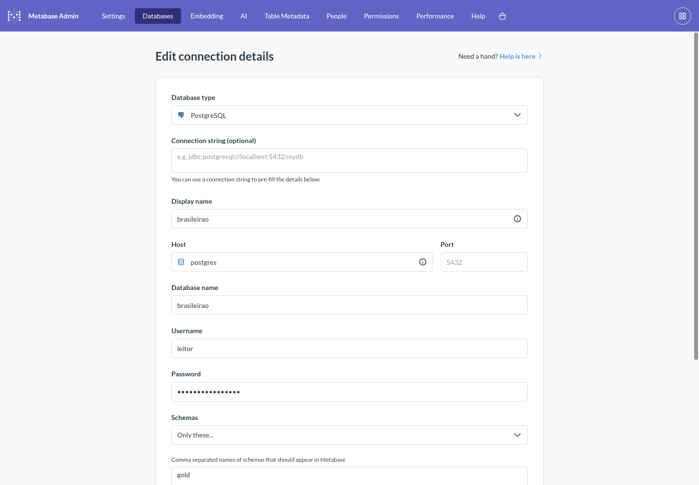
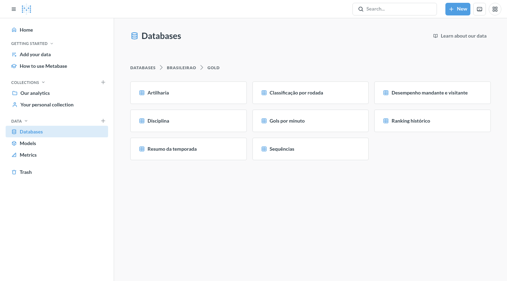
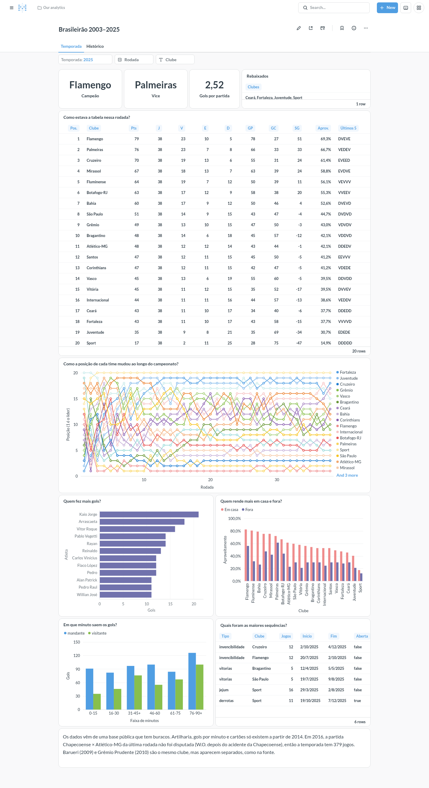
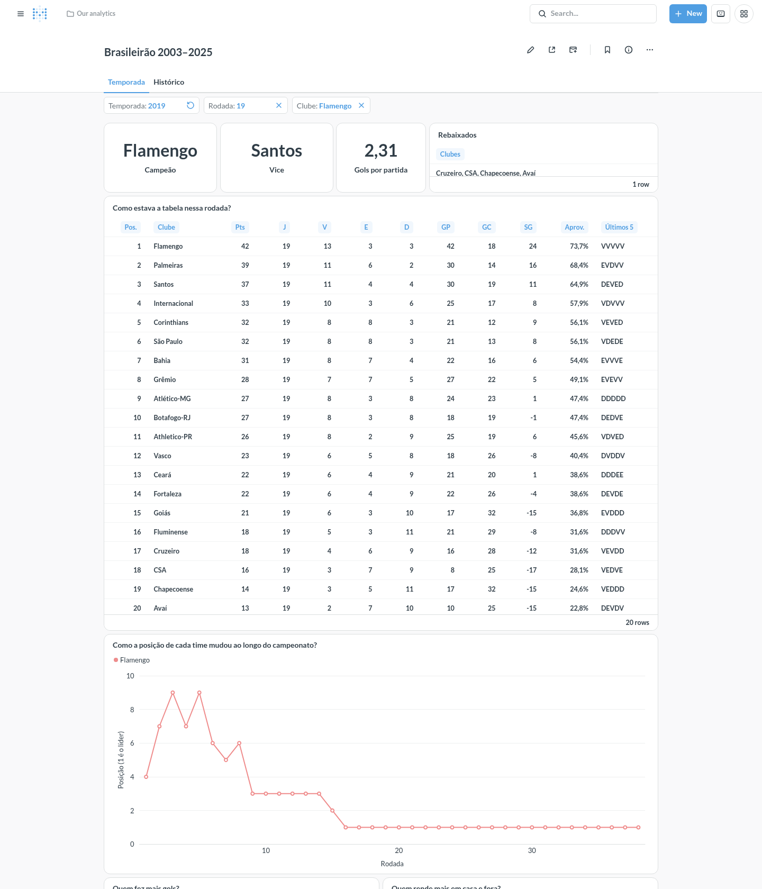
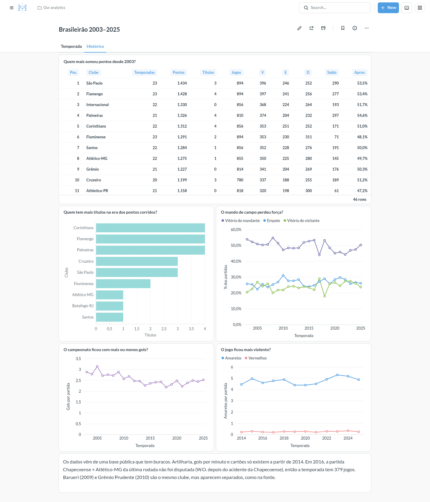

# Postgres e Metabase

Queria que o gold saísse do Delta e chegasse num banco de verdade, com um dashboard em cima, do jeito que costuma ser numa empresa. Então montei essa camada com Postgres e Metabase em Docker Compose. Ela roda na minha máquina, e o caminho até a nuvem ficou no meio, como conto em [Até onde foi](#até-onde-foi). O app público do projeto é outro, um Streamlit que não depende de nada daqui.

## Como funciona

Ao rodar local, o caminho dos dados é este:

```
gold (Delta) ── make carga ──→ Postgres ──→ Metabase (localhost:3000)
                 papel carga     banco brasileirao      papel leitor
```

O compose em [`serving/docker-compose.yml`](../../serving/docker-compose.yml) sobe dois serviços, com as imagens em tag fixa. As portas 5432 e 3000 só escutam em `127.0.0.1`, então nada disso aparece na rede.

O Postgres guarda dois bancos. O `brasileirao` tem as 8 tabelas do gold e o `metabase` tem as coisas do próprio Metabase, como perguntas, dashboards e usuários. Por isso dá pra recarregar o gold sem encostar no dashboard, e o contrário também.

## Papéis e segurança

Cada peça conecta com um usuário que só faz o que ela precisa. Os papéis são criados em [`serving/initdb/`](../../serving/initdb/) na primeira subida, com as senhas vindas do `.env`, que fica fora do git.

| Papel | Quem usa | O que pode |
|---|---|---|
| `carga` | `make carga` | é dono dos schemas `gold` e `gold_carga`, conecta só no `brasileirao` |
| `leitor` | as perguntas do Metabase | `SELECT` no schema `gold` e nada além disso |
| `metabase` | a aplicação do Metabase | é dono do banco `metabase`, não conecta no `brasileirao` |

O superusuário `postgres` fica para administração. Nenhuma peça do dia a dia usa ele.

O `leitor` é o que mais importa, porque o Metabase deixa escrever SQL livre. Se alguém mandar um `DELETE` por ali, quem recusa é o banco. Conferi isso no Postgres local como `leitor`:

```
DELETE FROM gold.artilharia                   → permission denied for table artilharia
SELECT count(*) FROM gold_carga.artilharia    → permission denied for schema gold_carga
psql -d metabase                              → User does not have CONNECT privilege
```

A conexão no Metabase usa esse papel, com a lista de schemas limitada ao `gold`.



As 8 tabelas aparecem e o `gold_carga` não.



## Carga atômica

Um dashboard não pode ver tabela pela metade, então a carga ([`carga.py`](../../src/brasileirao/serving/carga.py) e [`postgres.py`](../../src/brasileirao/serving/postgres.py)) tem dois passos.

1. O Spark grava as 8 tabelas no schema `gold_carga`, por JDBC. O `leitor` não enxerga esse schema, então dá pra demorar o quanto for preciso.
2. Uma transação só faz `TRUNCATE` e `INSERT ... SELECT` de cada tabela do `gold_carga` para o `gold`. Se qualquer passo falhar, o Postgres desfaz tudo e o `gold` fica como estava.

No fim, a carga compara as linhas de cada tabela com as do Delta e falha se alguma divergir. Antes de gravar, ela também confere as colunas contra [`tabelas.py`](../../src/brasileirao/serving/tabelas.py), e um gold que mudou de schema derruba a carga antes de gravar qualquer coisa.

Usei `TRUNCATE` em vez de apagar e recriar a tabela porque assim os grants, as chaves primárias e a referência que o Metabase guarda continuam valendo.

Com o gold real, as contagens em `gold` são estas:

| Tabela | Linhas |
|---|---|
| `classificacao_por_rodada` | 18.332 |
| `artilharia` | 3.614 |
| `sequencias` | 1.880 |
| `desempenho_mandante_visitante` | 940 |
| `disciplina` | 240 |
| `gols_por_minuto` | 144 |
| `ranking_historico` | 46 |
| `resumo_temporada` | 23 |

## Postgres no CI

O job `test` do [CI](../../.github/workflows/ci.yml) sobe um `postgres:17.11`, a mesma tag do compose, e roda os testes marcados com `postgres`. Cada módulo de teste cria um banco descartável e aplica o `initdb/` de verdade, então o DDL e os grants são os mesmos do compose. Sem `BRASILEIRAO_PG_TESTE_URL`, esses testes são pulados.

Os testes em [`test_serving.py`](../../tests/integration/test_serving.py) cobrem, entre outras coisas, carga repetida dando o mesmo resultado, falha no meio da troca sem mudar o `gold` e tudo que o `leitor` não pode fazer.

## O dashboard

O [`dashboard.md`](dashboard.md) registra as 12 perguntas, com o SQL de cada uma. Elas estão montadas no Metabase local, em duas abas. A primeira mostra uma temporada, com filtros de temporada, rodada e clube.



Com os filtros em 2019, rodada 19 e Flamengo, a tabela volta para o meio daquele campeonato e o gráfico de posição fica só com uma linha.



A segunda aba olha o período inteiro, de 2003 a 2025.



Conferi a tabela final de 2025 do card contra o `gold`, linha a linha, e bateu.

Duas coisas ficaram diferentes do que o `dashboard.md` pede. No gráfico de posição, o líder aparece embaixo, porque não achei como inverter o eixo no Metabase. E os rebaixados viraram uma tabelinha, porque os nomes não cabem num cartão de número. Também só traduzi os nomes das tabelas e os títulos dentro dos cards, o modelo de dados ficou com os nomes de coluna originais.

## Como rodar

Precisa de Docker, além do que o [README da raiz](../../README.md) já pede, e de ter rodado `make gold`.

```bash
cp serving/.env.example .env   # e trocar as senhas
make serving-up                # sobe Postgres e Metabase
make carga                     # gold → Postgres
make serving-down              # derruba sem apagar o volume
```

Depois é abrir <http://localhost:3000>, criar o admin e seguir o "Como montar" do [`dashboard.md`](dashboard.md). No cadastro do banco, o host é `postgres`, o nome do serviço na rede do compose, porque `localhost` dentro do container seria o próprio Metabase.

As perguntas e o dashboard moram no banco `metabase`, dentro do volume do Docker, e não no git. Se o volume sumir, é remontar pelo `dashboard.md`.

## Até onde foi

A ideia inicial era publicar tudo numa VM Always Free da Oracle, com HTTPS e um link público do Metabase. Não publiquei. Quando fui criar a conta, em novembro de 2026, o cadastro da Oracle no Brasil só oferecia o tipo Corporate e pedia CNPJ, recusando CPF, e eu não tenho CNPJ. A documentação deles ainda fala em CPF. Sem conta, a nuvem saiu do plano e o app público foi para o Streamlit.

As peças de deploy ficaram no repositório. Estão prontas e **nunca rodaram em produção**.

- O serviço `caddy` no compose, no profile `publico`, com o [`Caddyfile`](../../serving/Caddyfile) para HTTPS.
- `make deploy`, que copia `serving/` para a VM por `rsync` e sobe o compose por SSH.
- `make carga-remota`, que faz a carga por um túnel SSH até o Postgres da VM.
- `make backup-metabase`, que faz o dump do banco `metabase` da VM.

O que conferi nelas foi só de fora, com `docker compose config` e `make -n`, que mostram se a configuração é válida e quais comandos sairiam. Nenhuma VM foi criada e nada daqui ficou acessível pela internet.
